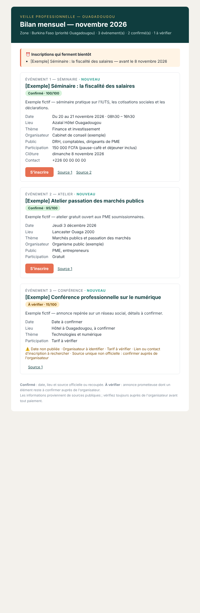

# Veille Pro Ouaga

Agent de veille automatique sur les **formations, conférences, séminaires, ateliers et forums professionnels** à Ouagadougou et au Burkina Faso, en particulier dans les grands hôtels et centres de conférence (Lancaster Ouaga 2000, Bravia, Sopatel Silmandé, Azalaï, Laïco…).

Chaque jour, il cherche les annonces, en extrait les informations utiles, les **vérifie**, les **classe** (confirmé / à vérifier) et vous envoie un **bulletin** par e-mail, Telegram ou WhatsApp, pour que vous puissiez vous inscrire à temps.



> L'aperçu ci-dessus utilise des **événements fictifs** (`docs/generer_exemple.py`), uniquement pour montrer le format.

---

## Fonctionnement

```
 ┌──────────── COLLECTE (chaque jour, 06:15) ────────────┐
 │ 1. Presse / actualités  (Google News, gratuit)        │
 │ 2. Pages suivies        (sites d'hôtels, agendas)     │
 │ 3. Recherche web IA     (Gemini + Google Search,      │
 │    ou Claude : LinkedIn, Facebook, presse BF…)        │
 └───────────────────────────┬───────────────────────────┘
                             ▼
   EXTRACTION   Gemini / Claude → fiche structurée par événement
                (sans clé : extraction par mots-clés et dates en français)
                             ▼
   VÉRIFICATION score 0–100 : date, lieu surveillé, organisateur, tarif,
                lien d'inscription testé, source officielle, recoupement
                → ✅ confirmé | 🔎 à vérifier | passé | annulé
                             ▼
   BASE         data/evenements.json (dédoublonnage, historique des envois)
                             ▼
   BULLETIN     filtres (thèmes, budget, zone, horizon) → HTML / Markdown / message
                             ▼
   ENVOI        e-mail · Telegram · WhatsApp   +  archive dans reports/
```

| Étape | Ce que fait l'agent |
|---|---|
| **Recherche** | Formations, conférences, forums, ateliers, séminaires et rencontres professionnelles des 120 prochains jours. Les comptes rendus d'événements passés (« retour en images ») sont écartés. |
| **Hôtels surveillés** | Liste modifiable dans `config/config.yaml` (13 lieux préconfigurés, à confirmer et compléter). |
| **Vérification** | Dates, lieu, organisateur, frais, conditions et lien d'inscription. Rien n'est inventé : une information absente est notée « à vérifier ». |
| **Bulletin** | Événements confirmés d'abord, puis ceux à vérifier. Alerte ⏰ sur les inscriptions qui ferment dans les 10 jours. Badge 🆕 sur les nouveautés. |

### Calendrier d'envoi (`frequence`)

| Valeur | Envois |
|---|---|
| `quotidien` | Alerte chaque jour (seulement s'il y a du nouveau) + bilan le 1er du mois |
| `hebdo_et_mensuel` *(défaut)* | Bulletin chaque lundi + bilan complet le 1er du mois |
| `mensuel` | Bilan complet le 1er du mois |

---

## Mise en service (environ 15 minutes)

### 1. Récupérer le dépôt sur GitHub
Le dépôt contient déjà la planification (`.github/workflows/veille.yml`). Rien à installer sur votre ordinateur.

### 2. Régler vos préférences
Modifiez `config/config.yaml` :

| Réglage | Options |
|---|---|
| `thematiques` | `toutes: true`, ou une sélection parmi entrepreneuriat, finance, numérique, marketing, management, marchés publics, développement personnel, diplomatie |
| `budget.mode` | `gratuit` · `petit_prix` (plafond `plafond_fcfa`) · `tous` |
| `frequence` | `quotidien` · `hebdo_et_mensuel` · `mensuel` |
| `canaux` | `email`, `telegram`, `whatsapp` (un ou plusieurs) |
| `zone` | `ouagadougou` · `burkina` (tout le pays, priorité Ouaga) |
| `lieux`, `organismes`, `pages_suivies`, `requetes_actualites` | Sources à surveiller |

### 3. Ajouter les secrets
Dans GitHub : **Settings → Secrets and variables → Actions → New repository secret**.

| Secret | Rôle | Obligatoire |
|---|---|---|
| `GEMINI_API_KEY` | IA **gratuite** de Google : recherche web + extraction fiable ([aistudio.google.com/apikey](https://aistudio.google.com/apikey)) | Fortement recommandé |
| `ANTHROPIC_API_KEY` | Alternative payante (Claude), avec `recherche_ia.fournisseur: claude` | Facultatif |
| `SMTP_HOST`, `SMTP_PORT`, `SMTP_USER`, `SMTP_PASSWORD`, `EMAIL_TO` (+ `EMAIL_FROM`) | E-mail | Si canal `email` |
| `TELEGRAM_BOT_TOKEN`, `TELEGRAM_CHAT_ID` | Telegram | Si canal `telegram` |
| `WHATSAPP_TO` + `CALLMEBOT_APIKEY` *ou* `TWILIO_ACCOUNT_SID`, `TWILIO_AUTH_TOKEN`, `TWILIO_WHATSAPP_FROM` | WhatsApp | Si canal `whatsapp` |

Sans clé d'IA valide, l'agent fonctionne quand même (presse + pages suivies, extraction par mots-clés), mais la couverture est plus faible et tout est classé « à vérifier ».

<details>
<summary><b>Gmail</b> : obtenir un mot de passe SMTP</summary>

Activez la validation en deux étapes, puis créez un **mot de passe d'application** (Compte Google → Sécurité → Mots de passe des applications). Utilisez `SMTP_HOST=smtp.gmail.com`, `SMTP_PORT=587`, `SMTP_USER=votre adresse`, `SMTP_PASSWORD=le mot de passe d'application`.
</details>

<details>
<summary><b>Telegram</b> : créer le bot (gratuit)</summary>

1. Dans Telegram, écrivez à **@BotFather** → `/newbot` → copiez le jeton (`TELEGRAM_BOT_TOKEN`).
2. Envoyez un message quelconque à votre nouveau bot.
3. Ouvrez `https://api.telegram.org/bot<JETON>/getUpdates` et relevez `"chat":{"id": …}` (`TELEGRAM_CHAT_ID`).
</details>

<details>
<summary><b>WhatsApp</b> : CallMeBot (gratuit) ou Twilio (officiel)</summary>

- **CallMeBot** (usage personnel) : ajoutez le numéro CallMeBot à vos contacts, envoyez-lui *« I allow callmebot to send me messages »*, et vous recevez une clé (`CALLMEBOT_APIKEY`). `WHATSAPP_TO` = votre numéro au format `+226…`. Laissez `whatsapp_fournisseur: callmebot`.
- **Twilio** (API WhatsApp officielle, payante) : créez un compte, activez l'expéditeur WhatsApp et mettez `whatsapp_fournisseur: twilio`.
</details>

### 4. Tester
**Actions → Veille quotidienne → Run workflow** :
1. `test-envoi` : vérifie que chaque canal reçoit bien un message.
2. `collecter` : lance une première collecte (résultat dans `data/evenements.json`).
3. `bulletin-mensuel` : envoie immédiatement le récapitulatif complet.

Ensuite, tout est automatique : collecte chaque matin, bulletins selon votre fréquence. La base et les bulletins archivés (`reports/`) sont enregistrés dans le dépôt après chaque exécution.

---

## Utilisation en local

```bash
python -m venv .venv && source .venv/bin/activate
pip install -r requirements.txt
cp .env.example .env        # puis remplissez vos clés

python -m veille collecter                         # rechercher et enregistrer
python -m veille liste                             # voir la base
python -m veille bulletin --periode mensuel        # aperçu (rien n'est envoyé)
python -m veille bulletin --periode hebdo --envoyer
python -m veille test-envoi
python -m veille planifie                          # ce que lance le planificateur chaque jour
```

Tests : `pip install pytest && python -m pytest`

---

## Organisation du code

```
config/config.yaml        Préférences, lieux, organismes, requêtes
veille/sources.py         Collecteurs : actualités RSS, pages suivies, recherche web Claude
veille/gemini.py          Recherche Google + extraction avec Gemini (gratuit)
veille/llm.py             Extraction structurée avec Claude (sorties JSON validées)
veille/heuristique.py     Extraction de secours sans IA (dates en français, tarifs FCFA…)
veille/verification.py    Score de confiance et statut confirmé / à vérifier
veille/store.py           Base JSON, dédoublonnage et fusion des sources
veille/filtres.py         Thèmes, budget, zone, horizon et ordre de présentation
veille/rapport.py         Bulletins HTML, Markdown et messages courts
veille/notifications/     E-mail (SMTP), Telegram, WhatsApp (CallMeBot / Twilio)
veille/pipeline.py        Enchaînement des étapes et calendrier d'envoi
.github/workflows/        Exécution quotidienne + tests
```

## Coût et limites

- **GitHub Actions** : gratuit pour cet usage (quelques minutes par jour).
- **Gemini** : l'offre gratuite couvre la collecte quotidienne (3 recherches + 2 à 3 extractions par jour).
- **Claude** (optionnel) : généralement quelques centimes de dollar par jour ; réglez `recherche_ia.max_recherches` et `recherche_ia.effort`.
- LinkedIn et Facebook ne permettent pas d'être lus directement par un robot : l'agent n'y accède qu'à travers leurs **publications publiques indexées** par les moteurs de recherche. Pour une page précise (hôtel, cabinet), ajoutez son site à `pages_suivies`.
- Les informations viennent de sources publiques : **vérifiez toujours auprès de l'organisateur avant de payer**.
